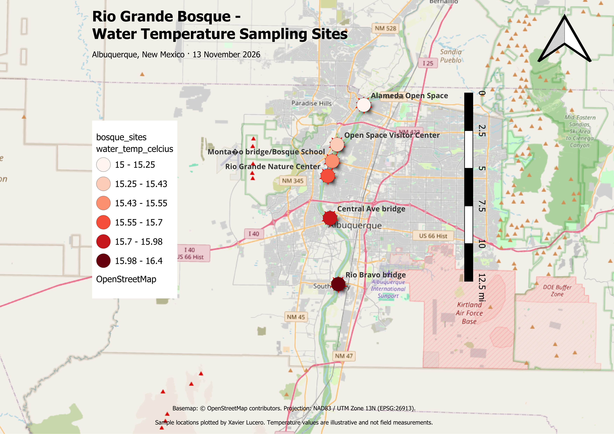

# Rio Grande Bosque water temperature map

Six sampling sites along the Rio Grande through Albuquerque, mapped in QGIS with water temperature shown by color.

**The temperature values are illustrative. They are not field measurements.** I generated them along a gradient of about 0.1 to 0.2 °C per mile downstream, so they vary the way real readings might. Anyone could collect the real thing with a thermometer and a sample cup on a decent day, and the file structure would take them as they are.

## Method

I picked the sites off the map between Alameda and Rio Bravo, pulled latitude and longitude for each one from Google Maps in decimal degrees (WGS 84, EPSG:4326), and loaded them from a CSV. The project is set to NAD83 / UTM Zone 13N (EPSG:26913), which is the projection for this part of New Mexico. That puts the map in meters instead of degrees, so the scale bar and any distance I measure are correct.

Points are graduated by temperature across five classes. The basemap is OpenStreetMap.

## Files

- `bosque_sites.csv` — source data
- `bosque_sites.gpkg` — the spatial layer
- `bosque_water_temp.qgz` — the QGIS project
- `bosque_water_temp_map.pdf` / `.png` — the exported map
---
Related: [bosque-groundwater-leaf-litter](https://github.com/xlucero/bosque-groundwater-leaf-litter) — analysis of ten years of BEMP groundwater and leaf litter records.